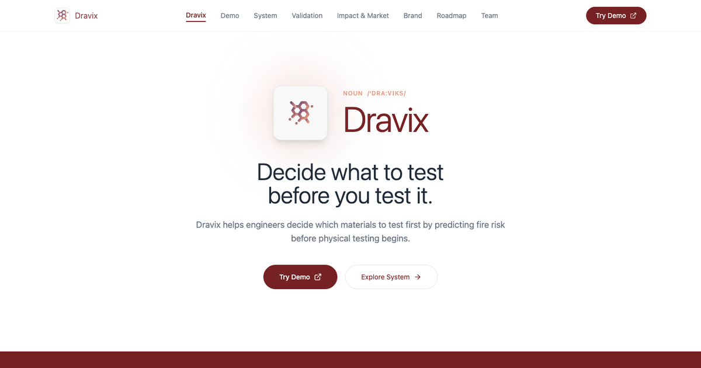
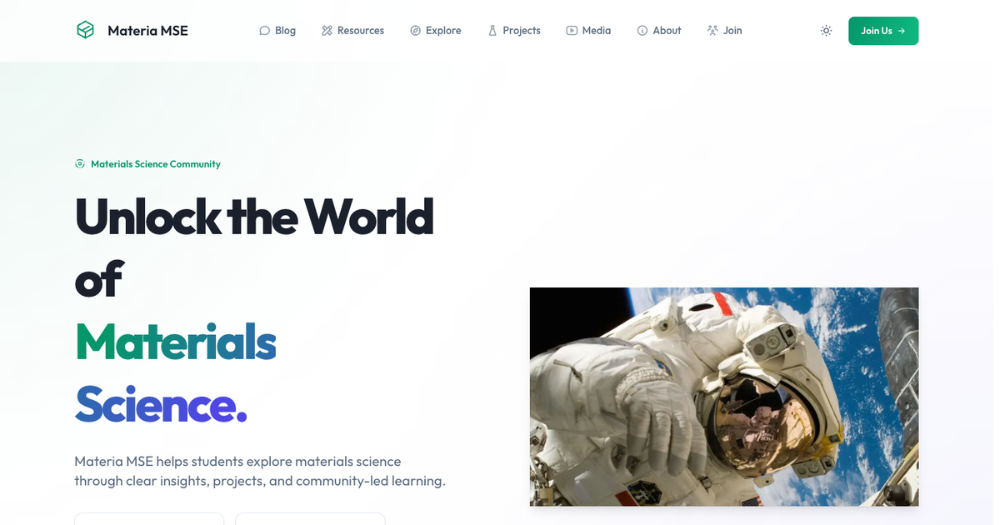
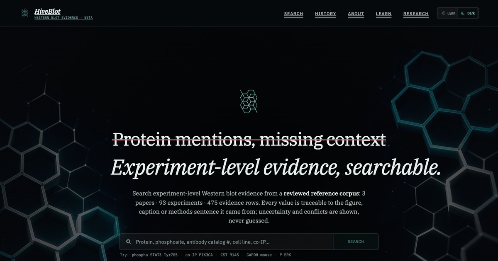
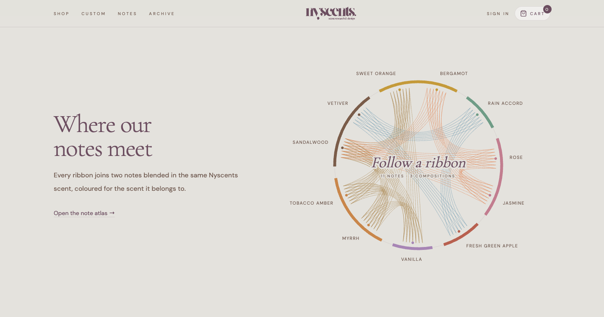
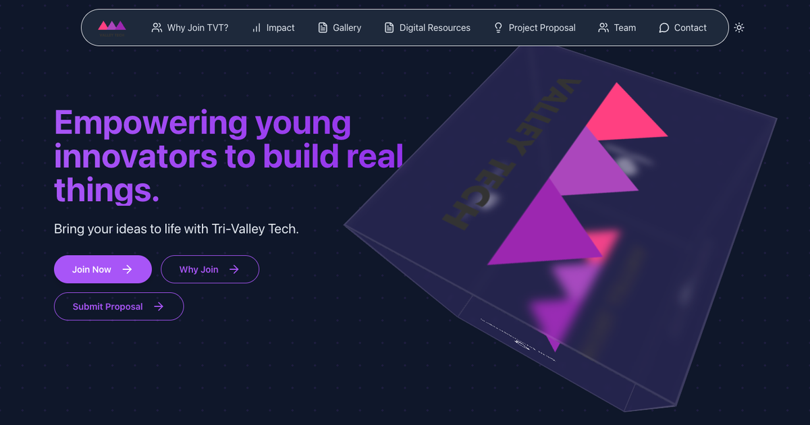
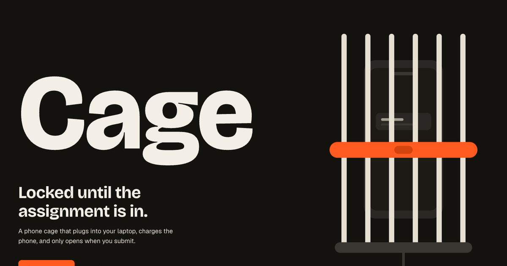

# Nikhilesh Suravarjjala

I design and build research tools, websites, and brands. Right now that means machine learning for material fire risk, computational crystal screening, and evidence tools for bench biology.

[Portfolio](https://nikhileshsuravarjjala.com) · [Materia MSE](https://www.materiamse.com) · [NYSCENTS](https://nyscents.nikhileshsuravarjjala.com)

## Research, with receipts

Every row has a citable record or a public benchmark. Limits are listed next to the results.

| Project | What it does | Evidence | Cite |
|---|---|---|---|
| [**HiveBlot**](https://github.com/nikhilesh-s/hive) | Finds Western blot results across papers and traces each one to the lane and figure it came from. | Pre-registered blind benchmark on 3 papers: 512 of 553 extracted values were correct (92%), with 57% coverage. About 6x faster before review (19.8 vs 123.5 min). | [Software](https://doi.org/10.5281/zenodo.23491677) · [Benchmark](https://doi.org/10.5281/zenodo.23524346) |
| [**Dravix**](https://github.com/nikhilesh-s/release-dravix) | Ranks polymers by fire risk from cone-calorimeter data before physical testing. | Open code and open dataset. Paper-grouped scores are modest (pHRR R² 0.286), and the repo says so. | [Software](https://doi.org/10.5281/zenodo.23653502) · [Dataset](https://doi.org/10.5281/zenodo.23654307) |
| [**Project Halide**](https://github.com/nikhilesh-s/project-halide) | Predicted NaSbBr4 and LiSbBr4 crystal models, screened with MACE and refined with Quantum ESPRESSO. | Seven compositions pass the energy gates. Two went through convergence, dispersion and phonon checks. These are predicted models, not synthesized materials. | [NOMAD dataset](https://doi.org/10.17172/nomad.j0ce-ctz1) |
| **MatSci RL** | Reinforcement learning for materials discovery. Under wraps. | Accepted at AIAS+ SF. | |

## Selected projects

<table>
  <tr>
    <td width="50%" valign="top"> <b>Dravix</b> Machine-learning screening that ranks materials by fire risk before physical testing. <a href="https://dravix.materiamse.com">Site</a> · <a href="https://dravix-engine.materiamse.com">Engine</a></td>
    <td width="50%" valign="top"> <b>Materia MSE</b> A materials science hub for students, with explainers, interactive tools and projects.</td>
  </tr>
  <tr>
    <td width="50%" valign="top"> <b>HiveBlot</b> Search engine for experiment-level Western blot evidence, traced back to the source figure.</td>
    <td width="50%" valign="top"> <b>NYSCENTS</b> A small fragrance studio: brand identity, storefront and a scent note atlas. <a href="https://nyscents.nikhileshsuravarjjala.com">Site</a> · <a href="https://memory2scent.nikhileshsuravarjjala.com">Memory2Scent</a>, a small neural network that turns a childhood memory into a fragrance concept</td>
  </tr>
  <tr>
    <td width="50%" valign="top"> <b>Tri-Valley Tech</b> Website for a student-run nonprofit where high schoolers build tech projects.</td>
    <td width="50%" valign="top"> <b>Cage</b> A phone cage that stays locked until your assignment is submitted.</td>
  </tr>
</table>

**Also:** [Thought Dock](https://thought-dock-peach.vercel.app) · [SpeakersCircle](https://www.speakerscircle.org) · [Financial Folks](https://www.financial-folks.com) · [National Letters](https://letters.neurohealthalliance.org) · [VOC-Triage](https://voc-t-design-1.vercel.app) · [Music](https://nikhilesh-music.vercel.app)

## What would move these forward

- **Dravix:** more labeled cone-calorimeter data from different papers. Paper-grouped accuracy is the weak point.
- **HiveBlot:** more annotated papers to raise the 57% coverage, and a larger blind benchmark.
- **Project Halide:** compute time for the next round of candidates.

I am open to grants, compute credits, and collaborations. The fastest way to reach me is through the [portfolio](https://nikhileshsuravarjjala.com).
